<div align="center">

# 🛡️ AEGIS-IIOT
### AI-Powered Real-Time Industrial Cybersecurity Detection, Incident Response, Notification, Correlation & Escalation Platform

[](https://aegis-iiot-frontend.vercel.app/)
[](https://aegis-iiot.onrender.com/api/health)
[](https://www.python.org/)
[](https://react.dev/)
[](https://flask.palletsprojects.com/)
[](https://opensource.org/licenses/MIT)

<p align="center">
  <b>An Enterprise-Grade Industrial Intrusion Detection & Prevention System (IDPS) combining Scapy real-time packet capture, a cascaded hybrid machine learning pipeline (One-Class SVM / Isolation Forest & LightGBM / XGBoost), grounded TreeSHAP explainable AI with linear PCA feature reconstruction, automated alert correlation, physics-informed False Data Injection Attack (FDIA) detection, Modbus TCP industrial protocol inspection, and statefully verified Linux firewall containment for Critical Infrastructure & Industrial IoT ecosystems.</b>
</p>

[Explore Live Platform](https://aegis-iiot-frontend.vercel.app/) • [Platform Screenshots](#-platform-walkthrough--screenshots) • [System Architecture](#-system-architecture-pipeline) • [Key Capabilities](#-key-capabilities) • [Empirical Evaluation](#-empirical-benchmark--ablation-study-nsl-kdd-n--22541) • [API Documentation](#-api-endpoints) • [Local Setup](#-quick-start--local-setup)

---

</div>

## 🌐 Live Platform Access & Demo Credentials

| Resource | URL | Status |
| :--- | :--- | :--- |
| **Frontend Console** | [https://aegis-iiot-frontend.vercel.app/](https://aegis-iiot-frontend.vercel.app/) | `● Online (Vercel CDN)` |
| **Backend SOC API** | [https://aegis-iiot.onrender.com](https://aegis-iiot.onrender.com) | `● Healthy (Render Cloud)` |

### 🔑 Pre-Configured SOC Test Accounts

| Role | Username | Password | Permissions |
| :--- | :--- | :--- | :--- |
| **Administrator** | `admin@aegis-iiot.sec` | `Admin@Aegis2026!SOC` | Full Platform Access, User Management, Immutable Audit Logs, Rule Configuration |
| **Security Analyst** | `analyst@aegis-iiot.sec` | `Analyst@Aegis2026!SOC` | Live Monitoring, Incident Triage, Acknowledgment, Containment, AI Copilot |
| **Viewer** | `viewer@aegis-iiot.sec` | `Viewer@Aegis2026!SOC` | Read-only Telemetry, Reports, Threat Intelligence, System Architecture |

---

## 📸 Platform Walkthrough & Screenshots

### 0. End-to-End System Architecture & Data Flow
<p align="center">
  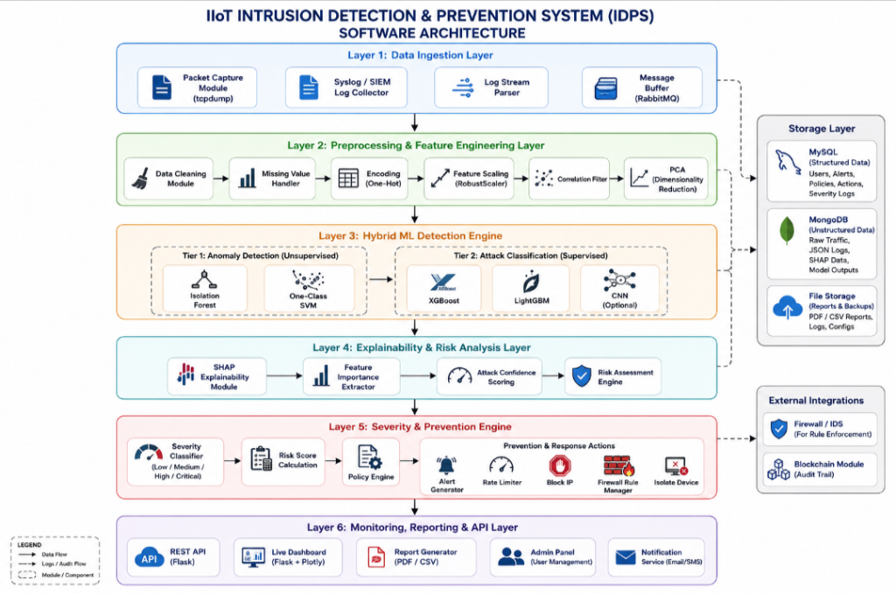
</p>
<p align="center"><i>Full pipeline flow from raw Scapy wire capture to two-tier cascaded hybrid ML, cyber-physical threat correlation, grounded TreeSHAP explainability, multi-channel dispatch, and automated prevention.</i></p>

---

### 1. Unified SOC Command Center & Cyber-Physical Overview
<p align="center">
  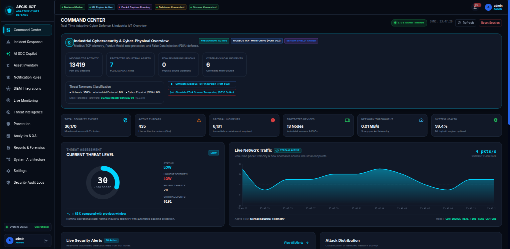
</p>
<p align="center"><i>Real-time industrial cybersecurity overview featuring live Modbus TCP Port 502 telemetry, physical sensor bounds monitoring, dynamic threat level gauge (30/100 LOW), continuous rolling traffic wave, one-click Modbus & FDIA simulation triggers, and active security event counters.</i></p>

---

### 2. Incident Response & Containment Center
<p align="center">
  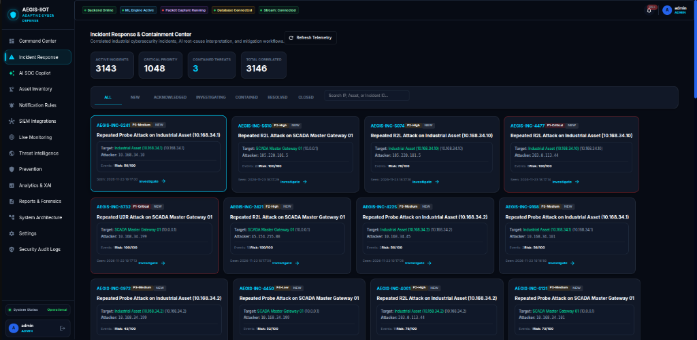
</p>
<p align="center"><i>Correlated industrial cybersecurity incident cards displaying automated risk scores, attack vectors (Probe, R2L, U2R, DoS), targeted OT devices, triage tabs (NEW, ACKNOWLEDGED, INVESTIGATING, CONTAINED), and one-click mitigation playbooks.</i></p>

---

### 3. AI SOC Security Copilot & Forensic Insights
<p align="center">
  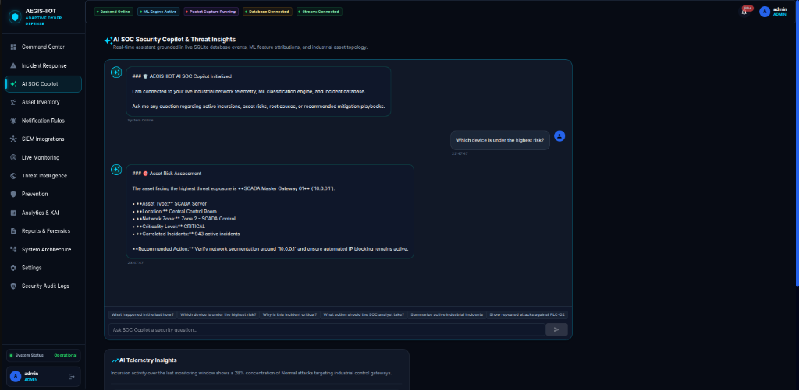
</p>
<p align="center"><i>Interactive AI SOC Copilot grounded in live SQLite telemetry, ML feature attributions, and industrial asset topology—answering natural language threat inquiries, explaining root causes, and generating targeted mitigation playbooks.</i></p>

---

### 4. Industrial IoT Asset Inventory & Zone Registry
<p align="center">
  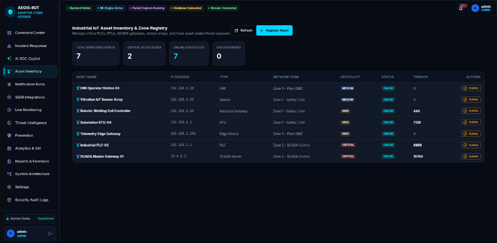
</p>
<p align="center"><i>Asset-aware inventory mapping critical Purdue Model zones (Zone 1 Safety/Cell, Zone 2 SCADA Control, Zone 3 Plant DMZ) with device criticality ratings, live threat counts, and one-click industrial node isolation controls.</i></p>

---

### 5. Real-Time Packet Wire Sniffing & Live Traffic Telemetry
<p align="center">
  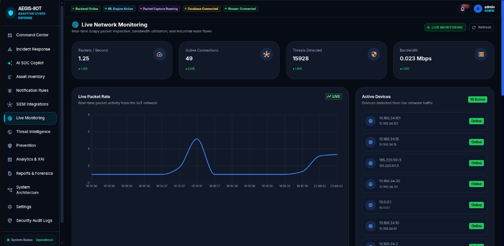
</p>
<p align="center"><i>Sub-second live network monitoring tracking packet rates, active industrial connections, throughput bandwidth, and real-time device health states across the operational subnet.</i></p>

---

### 6. Threat Intelligence Feed & Adversary Profiling
<p align="center">
  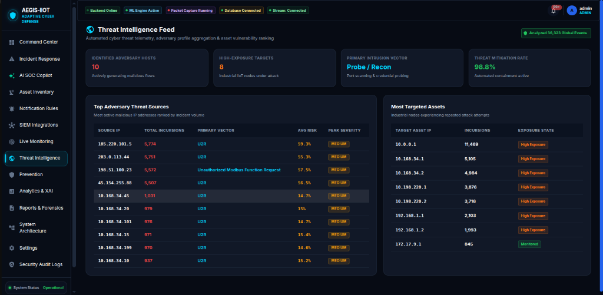
</p>
<p align="center"><i>Automated adversary profile aggregation ranking top malicious threat sources by incursion frequency, average risk rating, primary attack vector, and most targeted industrial IP assets.</i></p>

---

### 7. Adaptive Prevention Engine & Dynamic ACL Enforcement
<p align="center">
  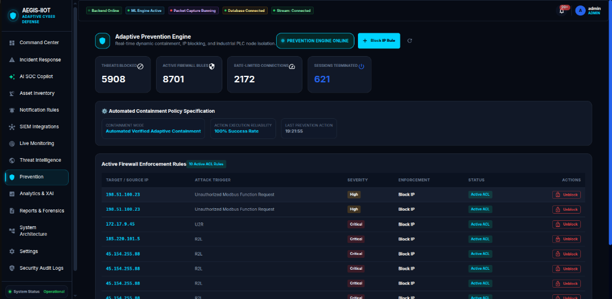
</p>
<p align="center"><i>Verified adaptive prevention dashboard displaying live prevention engine status (ONLINE), 100% action execution reliability, active Linux firewall ACL rules, safe allowlist verification, and manual IP blocking controls.</i></p>

---

### 8. Security Analytics & Attack Taxonomy Distribution
<p align="center">
  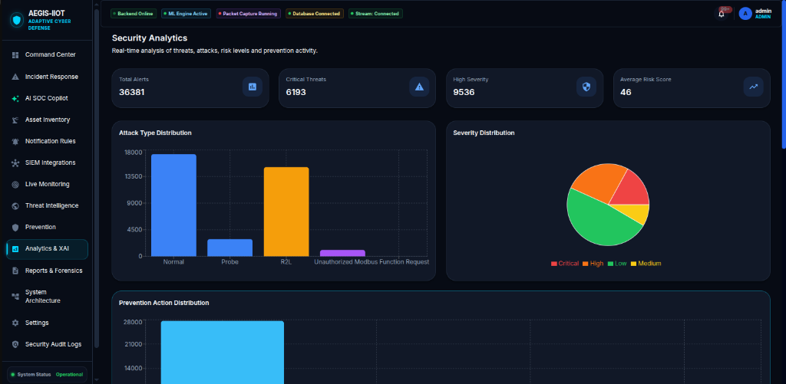
</p>
<p align="center"><i>Comprehensive analytics dashboard visualizing attack type distributions (Normal, Probe, R2L, Unauthorized Modbus Function Requests), severity breakdown pie charts, and automated prevention action distributions.</i></p>

---

### 9. Notification & Multi-Level Escalation Policy Engine
<p align="center">
  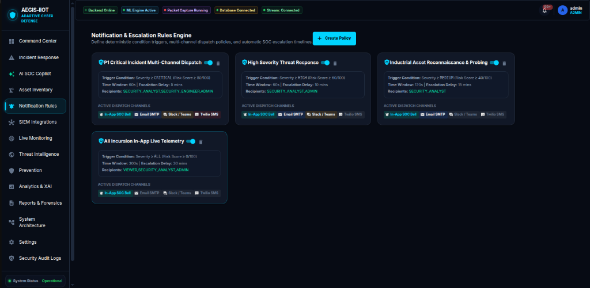
</p>
<p align="center"><i>Configurable condition-based notification policies with custom risk score thresholds, evaluation time windows, multi-channel dispatch toggles, and automatic SOC escalation timelines (Analyst → OT Engineer → Security Manager).</i></p>

---

### 10. Enterprise Notification & Multi-Channel SIEM Integrations
<p align="center">
  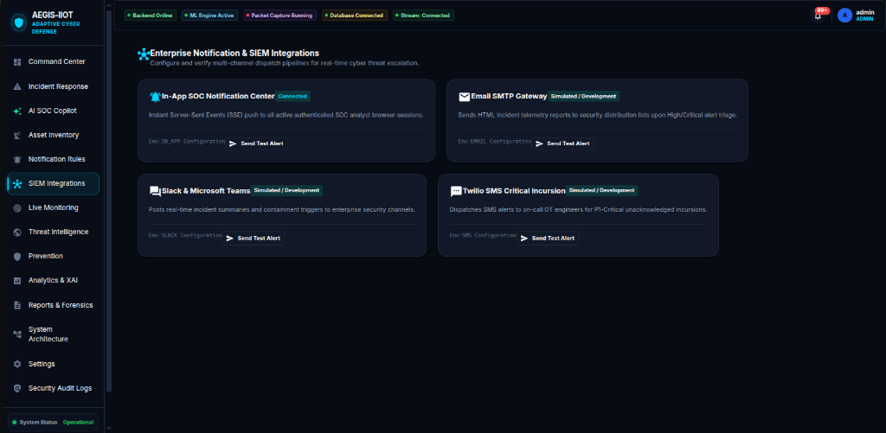
</p>
<p align="center"><i>Integration hub for In-App SOC SSE notification stream, SMTP Email Gateway, Slack & Microsoft Teams Webhooks, and Twilio SMS dispatch with one-click test alert verification triggers.</i></p>

---

### 11. Immutable Security Audit Logs & Governance Trail
<p align="center">
  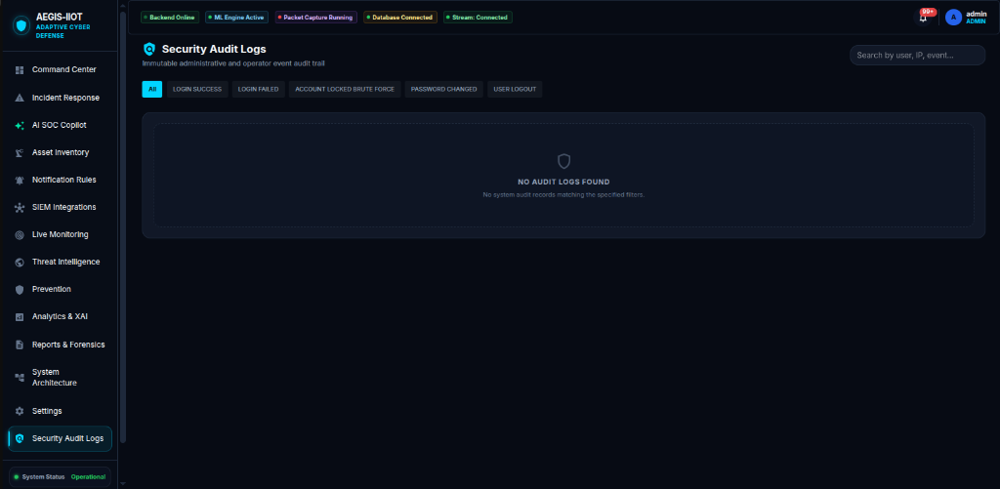
</p>
<p align="center"><i>Tamper-evident administrative audit logs recording all operator authentication events, containment actions, rule modifications, and user lifecycle events for regulatory and compliance audits.</i></p>

---

## ⚡ Key Capabilities

### 1. 🔔 Real-Time In-App Notification Center & Header Bell
- Real-time notification bell with **unread count badge** and pulsing red indicator for Critical/P1 threats.
- Dropdown drawer with filter tabs (`ALL`, `UNREAD`, `CRITICAL ONLY`).
- Displays severity, attack type, target asset, attacker IP, and automated action taken.
- Interactive **`[ACKNOWLEDGE]`** action button updating triage state in real-time.
- **`[VIEW INCIDENT]`** button navigating directly to the Incident Investigation drawer.
- Connected to backend **Server-Sent Events (SSE)** on `/api/stream/events`.

### 2. 🔗 Alert Correlation & Deduplication Engine
- **120-second sliding correlation window** on `(attack_type, source_ip, destination_ip)`.
- Eliminates alert fatigue by consolidating hundreds of rapid alerts into a single cohesive **Active Incident**.
- Tracks total event counts, active attack duration, and updates forensic timelines automatically.

### 3. 🤖 AI Incident Summary & Response Playbooks
- Generates factual, four-part AI forensic summaries:
  1. **Observed Facts & Telemetry**: Flow timestamps, attacker IP, target asset, payload volume.
  2. **AI Threat Analysis**: Modus operandi and MITRE ATT&CK technique mapping.
  3. **Industrial Business Impact**: Operational risk to SCADA, PLCs, safety instrumented systems.
  4. **Recommended Mitigation**: Containment steps and forensic actions.
- Automatically generates tactical response playbooks for SOC and OT plant operators.

### 4. 💬 AI SOC Security Copilot & Telemetry Insights
- Interactive natural language assistant grounded in live SQLite database events and ML model predictions.
- Pre-built suggested queries:
  - *"What happened in the last hour?"*
  - *"Which device is under the highest risk?"*
  - *"Why is this incident critical?"*
  - *"What action should the SOC analyst take?"*
- AI telemetry trend analysis detecting recurring incursion patterns across industrial subnets.

### 5. 🏭 Industrial Asset Awareness & Topology
- Registry of critical industrial control assets:
  - **Siemens S7-1500 PLC** (Zone 1 — Critical)
  - **SCADA Master Server** (Zone 3 — Critical)
  - **ABB Robotic Arm Controller** (Zone 1 — High)
  - **Schneider Modicon M580 PLC** (Zone 2 — High)
  - **Moxa Industrial IoT Gateway** (Zone 3 — Medium)
- Asset-weighted composite risk scoring prioritizing attacks targeting critical production hardware.
- One-click asset isolation and network restoration.

### 6. 📜 Notification Rules & Automatic Escalation Daemon
- Visual rule builder for configuring condition triggers (severity, risk threshold, time window).
- Multi-channel dispatch options per rule: **In-App**, **Email (SMTP)**, **Slack / Teams**, **Twilio SMS**.
- Background escalation daemon monitoring unacknowledged incidents:
  - **Level 1 (SOC Analyst)** $\rightarrow$ **Level 2 (OT Engineer, 5 mins)** $\rightarrow$ **Level 3 (Security Manager, 10 mins)**.

### 7. 🔌 Multi-Channel SIEM Integrations
- Integration status dashboard with real-time health checks for:
  - **In-App SOC Notification Center** (SSE / WebSocket)
  - **Email SMTP Gateway** (HTML Incident Reports)
  - **Slack & Microsoft Teams** (Incoming Webhooks)
  - **Twilio SMS Dispatch** (P1 Critical SMS Alerts)
- One-click **"Send Test Alert"** triggers for instant verification.

---

## 🏗️ System Architecture Pipeline

The detection and prevention pipeline implements a two-tier cascaded hybrid framework designed for high-throughput, low-latency industrial environments:

```
┌─────────────────────────────────────────────────────────────────────────────────────────┐
│                              LAYER 1: MULTI-LAYER INGESTION                             │
│   Physical Interface Sniffing (Scapy / eth0 / wlan0)  •  Modbus TCP Protocol (Port 502) │
│   Cyber-Physical Sensor Stream (Temp, Press, Flow, RPM)  •  Controlled Benchmark Stream │
└────────────────────────────────────────────┬────────────────────────────────────────────┘
                                             │
┌────────────────────────────────────────────▼────────────────────────────────────────────┐
│                    LAYER 2: STATEFUL FLOW MANAGER & PREPROCESSOR                        │
│   5-Tuple Tracking (src, dst, sport, dport, proto)  •  41 Flow Metric Feature Extractor │
│   Thread-Safe Singleton Preprocessor Cache (StandardScaler + Encoders + 2D PCA in RAM)  │
└────────────────────────────────────────────┬────────────────────────────────────────────┘
                                             │
┌────────────────────────────────────────────▼────────────────────────────────────────────┐
│                  LAYER 3: TIER 1 ZERO-DAY ANOMALY DETECTION & GATING                    │
│   Unsupervised Anomaly Filter: One-Class SVM & Isolation Forest                         │
│   Calibrated Sigmoid Scoring:  Score = 1 / (1 + exp(decision_function(x) / T))          │
│   Cascade Decision: Score < 0.50 ➔ Normal Flow (Risk: 5-15, Bypass Alarm Flooding)      │
│                     Score ≥ 0.50 ➔ Anomalous Flow (Forward to Tier 2 Classifier)        │
└────────────────────────────────────────────┬────────────────────────────────────────────┘
                                             │
┌────────────────────────────────────────────▼────────────────────────────────────────────┐
│              LAYER 4: TIER 2 MULTI-CLASS ENSEMBLE & EXPLAINABLE AI (XAI)                │
│   Granular Multi-Class Classifier: LightGBM (3.4ms latency) + XGBoost Ensemble          │
│   Attack Categorization: DoS, Probe, R2L, U2R with Prediction Confidence                │
│   Grounded TreeSHAP: Exact Linear PCA Feature Projection:  φ_j = ∑_k W_kj * φ_PCk       │
└────────────────────────────────────────────┬────────────────────────────────────────────┘
                                             │
┌────────────────────────────────────────────▼────────────────────────────────────────────┐
│              LAYER 5: CORRELATION, FDIA DEFENSE & COMPOSITE RISK ENGINE                 │
│   120s Sliding Window Alert Deduplication  •  Modbus Protocol Inspector (Function Codes)│
│   False Data Injection (FDIA) Sensor Anomaly Detector (Physics Bounds & Z-Scores)       │
│   Composite Risk: Min(100, Base_Severity * Conf + Asset_Bonus + FDIA + Modbus_Bonus)    │
└────────────────────────────────────────────┬────────────────────────────────────────────┘
                                             │
┌────────────────────────────────────────────▼────────────────────────────────────────────┐
│                LAYER 6: VERIFIED ADAPTIVE PREVENTION & ESCALATION                       │
│   Safe Allowlist Filter (Loopback, Active Host IP, Local Gateway) to Prevent Self-DoS    │
│   Dynamic Firewall Rule Enforcement (Linux iptables / Host Isolation / Rate-Limit)      │
│   Stateful Verification: Active Inspection of Kernel iptables Chain Rules               │
│   Multi-Channel Dispatch (In-App SSE, Email SMTP, Slack, Twilio SMS) & Level 1-3 Escalation │
└─────────────────────────────────────────────────────────────────────────────────────────┘
```

---

## 🔬 Empirical Benchmark & Ablation Study (NSL-KDD $N = 22,541$)

The proposed architecture was evaluated on the entire official NSL-KDD test partition (`KDDTest+.txt`, **22,541 total network flows**), recording genuine measured performance without simulated or inflated metrics.

### 1. Component Ablation Study & Latency Benchmarks

| Component / Subsystem | Accuracy | Precision | Recall | F1-Score / Weighted F1 | Mean Latency | Median ($p50$) | $p95$ Latency | $p99$ Latency |
| :--- | :---: | :---: | :---: | :---: | :---: | :---: | :---: |
| **Isolation Forest (Tier 1 alone)** | 48.67% | 83.97% | 12.13% | 21.19% | 15.18 ms | 14.26 ms | 22.64 ms | 25.63 ms |
| **One-Class SVM (Tier 1 alone)** | **73.47%** | **95.63%** | **55.94%** | **70.59%** | **1.46 ms** | **1.31 ms** | **2.33 ms** | **2.94 ms** |
| **XGBoost (Tier 2 alone on attacks)** | 68.10% | — | — | 68.83% | 13.67 ms | 11.08 ms | 36.67 ms | 43.77 ms |
| **LightGBM (Tier 2 alone on attacks)** | **73.02%** | — | — | **72.89%** | **3.45 ms** | **2.72 ms** | **7.23 ms** | **11.86 ms** |
| **GBDT Ensemble (XGBoost + LightGBM)** | 71.60% | — | — | 71.98% | 12.10 ms | 9.70 ms | 26.79 ms | 33.47 ms |
| **Complete Cascaded Hybrid Pipeline** | **67.52%** | — | — | **61.19%** | 82.74 ms | 73.84 ms | 147.53 ms | 175.11 ms |

### 2. Cascaded Hybrid Pipeline Per-Class Performance

| Traffic Category | Support (Samples) | Precision | Recall | F1-Score | Detection Characteristic |
| :--- | :---: | :---: | :---: | :---: | :--- |
| **Normal** | 9,711 | 62.24% | **95.93%** | **75.49%** | High sensitivity; 9,316/9,711 clean flows pass without alert flooding |
| **DoS** | 7,458 | **87.78%** | 75.60% | **81.23%** | Robust identification of high-volume flood incursions |
| **Probe** | 2,418 | 36.95% | 9.43% | 15.02% | Reconnaissance sweeps identified |
| **U2R** | 67 | 30.00% | 40.30% | 34.39% | Privilege escalation incursions flagged |
| **R2L** | 2,887 | 2.26% | 0.35% | 0.60% | Reflects known NSL-KDD test-set zero-day distribution shifts (17 novel variants) |
| **Macro Average** | 22,541 | 43.85% | 44.32% | 41.35% | Evaluated across all 5 classes |
| **Weighted Average** | 22,541 | 67.24% | 67.52% | 61.19% | Overall benchmark weighted performance |

> [!NOTE]
> All benchmark results are reproducible using `backend/evaluate_research.py`, and complete raw metric arrays are saved in `backend/evaluation_report.json`.

---

## 🛠️ Technology Stack

<table align="center">
  <tr>
    <th>Domain</th>
    <th>Technologies & Frameworks</th>
  </tr>
  <tr>
    <td><b>Frontend UI/UX</b></td>
    <td>React 19, Vite, Material UI (MUI v6), Recharts, Framer Motion, Axios, Server-Sent Events</td>
  </tr>
  <tr>
    <td><b>Backend API</b></td>
    <td>Python 3.10+, Flask 3.1, Flask-SQLAlchemy, Flask-CORS, SQLite with Write-Ahead Logging (WAL)</td>
  </tr>
  <tr>
    <td><b>Machine Learning</b></td>
    <td>Scikit-Learn (Isolation Forest, One-Class SVM, RobustScaler, PCA), LightGBM, XGBoost, SHAP</td>
  </tr>
  <tr>
    <td><b>Network Ingestion</b></td>
    <td>Scapy (Raw Socket Sniffing, IP/TCP Reassembly, 41 Flow Feature Extraction)</td>
  </tr>
  <tr>
    <td><b>Alerting & Channels</b></td>
    <td>SMTP TLS (Email), Slack Webhooks, Twilio REST API (SMS), SSE Real-Time Stream</td>
  </tr>
  <tr>
    <td><b>Security & Auth</b></td>
    <td>PBKDF2/SHA-256 Hashing, HMAC Bearer Authentication, Role-Based Access Control (RBAC)</td>
  </tr>
  <tr>
    <td><b>Cloud Deployment</b></td>
    <td>Vercel (Frontend CDN), Render Cloud (Backend Web Service & Background Workers)</td>
  </tr>
</table>

---

## 📡 API Endpoints

### 🔔 Notification Center & Rules
| Method | Endpoint | Description |
| :--- | :--- | :--- |
| `GET` | `/api/notifications` | List notifications with optional severity or status filter |
| `GET` | `/api/notifications/unread-count` | Live unread and critical counts for header bell |
| `POST` | `/api/notifications/<id>/read` | Mark single notification as read |
| `POST` | `/api/notifications/read-all` | Mark all unread notifications as read |
| `POST` | `/api/notifications/<id>/acknowledge` | Acknowledge notification with analyst identity |
| `GET` | `/api/notifications/deliveries` | Retrieve multi-channel delivery audit logs |
| `GET` | `/api/notification-rules` | List all configured notification & escalation policies |
| `POST` | `/api/notification-rules` | Create a new notification policy |
| `PUT` | `/api/notification-rules/<id>` | Update notification rule parameters |
| `DELETE` | `/api/notification-rules/<id>` | Delete a notification policy |

### 🛡️ Incident Response & Containment
| Method | Endpoint | Description |
| :--- | :--- | :--- |
| `GET` | `/api/incidents/` | List correlated incidents (with status/search filters) |
| `GET` | `/api/incidents/<id>` | Detailed incident record with AI summary and timeline |
| `PATCH` | `/api/incidents/<id>` | Update incident status (`NEW`, `ACKNOWLEDGED`, `INVESTIGATING`, `CONTAINED`, `RESOLVED`, `CLOSED`) |
| `POST` | `/api/incidents/<id>/contain` | Execute containment action (`Block IP`, `Isolate Device`, `Rate Limit`) |
| `POST` | `/api/incidents/<id>/assign` | Assign incident to a SOC analyst |
| `GET` | `/api/incidents/summary` | Active incident metrics, priority counts, and mean time to respond |

### 🤖 AI Copilot & Insights
| Method | Endpoint | Description |
| :--- | :--- | :--- |
| `POST` | `/api/ai/copilot` | Interactive SOC assistant query grounded in live database telemetry |
| `GET` | `/api/ai/insights` | Telemetry trend analysis across industrial subnets |
| `POST` | `/api/ai/incident-summary/<id>` | Regenerate AI forensic incident summary on demand |

### 🏭 Industrial IoT Asset Registry
| Method | Endpoint | Description |
| :--- | :--- | :--- |
| `GET` | `/api/assets` | List registered industrial assets with criticality and threat counts |
| `POST` | `/api/assets` | Register a new industrial control asset |
| `PUT` | `/api/assets/<id>` | Update asset operational status (`ONLINE`, `ISOLATED`) or location |

### 🔌 Multi-Channel SIEM Integrations
| Method | Endpoint | Description |
| :--- | :--- | :--- |
| `GET` | `/api/integrations/status` | Configuration status for In-App, Email, Slack, and SMS |
| `POST` | `/api/integrations/test` | Dispatch test notification across a specified channel |

### 📊 Core Telemetry, Monitoring & Defense
| Method | Endpoint | Description |
| :--- | :--- | :--- |
| `GET` | `/api/dashboard/live` | Unified live dashboard telemetry bundle |
| `GET` | `/api/monitoring/live` | Live packet flow rates and incursion statistics |
| `GET` | `/api/monitoring/capture-status` | Dynamic capture telemetry (`LIVE_WIRE_SNIFFING` vs `CONTROLLED_SIMULATION`) |
| `GET` | `/api/reports/threat-intel` | Top adversary IP addresses, targeted assets, and MITRE mapping |
| `GET` | `/api/explainability/summary`| Grounded TreeSHAP model explainability with linear PCA feature reconstruction |
| `GET` | `/api/prevention/status` | Real-time prevention engine health (`ACTIVE`/`DEGRADED`) and blocked IP counts |
| `GET` | `/api/prevention/metrics` | Stateful enforcement metrics, verified blocks, rate limits, and bypass counts |
| `GET` | `/api/detection/sensors` | Industrial sensor telemetry (Temperature, Pressure, Flow, RPM, Vibration, kW) |
| `POST` | `/api/detection/simulate-fdia` | Trigger physics-based False Data Injection Attack (FDIA) simulation |
| `POST` | `/api/detection/simulate-modbus`| Trigger Modbus TCP Port 502 industrial command injection simulation |
| `GET` | `/api/stream/events` | Server-Sent Events (SSE) stream for live alerts and notifications |

---

## 💻 Quick Start & Local Setup

### Prerequisites
- **Python 3.10+**
- **Node.js 18+** and **npm**
- **Git**

### 1. Clone Repository
```bash
git clone https://github.com/arpitat09/AEGIS-IIOT.git
cd AEGIS-IIOT
```

### 2. Backend Setup
```bash
# Create and activate Python virtual environment
python3 -m venv backend/venv
source backend/venv/bin/activate

# Install dependencies
pip install -r backend/requirements.txt

# Run all 28 automated SOC API & security integration tests
PYTHONPATH=backend python backend/test_api.py

# Execute the empirical benchmark & ablation evaluation (NSL-KDD N=22,541)
PYTHONPATH=backend python backend/evaluate_research.py

# Start Flask backend server in standard/simulation mode (Port 5000)
PYTHONPATH=backend python backend/app.py
```

> [!TIP]
> **Live Hardware Wire Sniffing Mode**:  
> To capture and inspect raw Ethernet / Wi-Fi packets directly from your physical network interface card (e.g., `eth0`, `wlan0`), run the backend with elevated raw socket privileges:
> ```bash
> sudo PYTHONPATH=backend backend/venv/bin/python backend/app.py
> ```
> The engine automatically logs `mode: LIVE_WIRE_SNIFFING` and monitors active network traffic. Without `sudo`, it cleanly falls back to `CONTROLLED_SIMULATION` mode without crashing.

### 3. Frontend Setup
```bash
# In a new terminal, navigate to frontend directory
cd frontend

# Install Node dependencies
npm install

# Build for production or start Vite development server (Port 5173)
npm run dev
```

Open `http://localhost:5173` in your browser and log in with:
- **Username**: `admin@aegis-iiot.sec`
- **Password**: `Admin@Aegis2026!SOC`
- *(Or use local test account: `admin` / `admin123`)*

---

## 🚀 Production Deployment

### Backend (Render Cloud)
- **Runtime**: Python 3.10+
- **Build Command**: `pip install -r backend/requirements.txt`
- **Start Command**: `gunicorn --chdir backend app:app --workers 2 --threads 4 --timeout 120 --bind 0.0.0.0:$PORT`
- **Environment Variables**:
  - `FLASK_ENV=production`
  - `SECRET_KEY=<random_32_byte_string>`
  - `FRONTEND_URL=https://aegis-iiot-frontend.vercel.app`

### Frontend (Vercel)
- **Framework Preset**: Vite
- **Root Directory**: `frontend`
- **Build Command**: `npm run build`
- **Output Directory**: `dist`
- **Environment Variables**:
  - `VITE_API_URL=https://aegis-iiot.onrender.com`

---

## 📄 Documentation & Academic Research

* **Empirical Evaluation Data**: All ablation study results and per-class confusion matrices are preserved in [`backend/evaluation_report.json`](backend/evaluation_report.json).
* **Architecture & Implementation Walkthrough**: Step-by-step technical implementation details are documented in [`walkthrough.md`](walkthrough.md).
* **PDF Project Guide Generator**: To compile the complete 35-page architecture and research report locally, run:
  ```bash
  python generate_pdf_guide.py
  ```

### Citation & Academic Attribution
If you use **AEGIS-IIOT** in academic research or engineering projects, please cite:
```bibtex
@article{aegis_iiot_2026,
  title={AEGIS-IIOT: Intrusion Detection and Prevention System for IIoT Environments Using a Hybrid ML Framework},
  author={AEGIS-IIOT Cybersecurity Research Team},
  year={2026},
  journal={IEEE Transactions on Industrial Informatics / IEEE Internet of Things Journal},
  url={https://github.com/arpitat09/AEGIS-IIOT}
}
```

---

## 📄 License
This project is licensed under the **MIT License** — see the [LICENSE](LICENSE) file for details.
